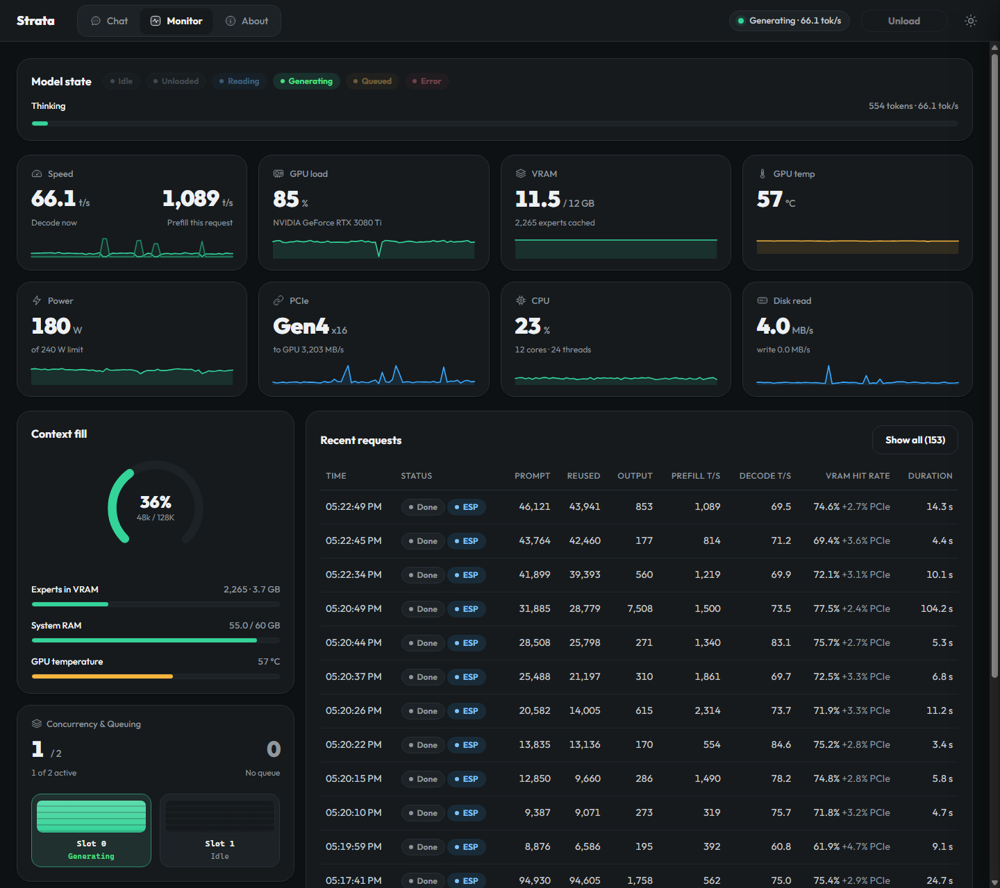

# Hydragen: Hybrid vLLM + Triton PagedMoE Engine (`hydragen` / `--engine vllm`)

A modular, installable Python package (`hydragen`) and vLLM plugin (`vllm.general_plugins`) that combines **vLLM's multi-slot concurrency, prefix caching, and Triton Fused MoE slot-indirection** with **tiered MoE expert hot-swapping, pinned host-RAM expert arena, GSQ sub-4-bit quantization (`IQ3_XXS` / `IQ2_XS` / `Q2_0_STRATA`), and 4-layer Multi-Token Prediction (MTP) speculative decoding**—purpose-built to serve massive MoE models (`Qwen3.8-Flash-Next`, 176.9B params, 512 experts/layer across 48 layers at `128k` context) on a single **12 GB VRAM consumer GPU** (`NVIDIA RTX 3080 Ti`).



---

## 1. The Idea & Motivation

Running large Mixture-of-Experts (MoE) models (such as `Qwen3.8-Flash-Next`, ~41 GiB in `GSQ-RCO-IQ3_XXS` quantization with 512 experts per layer across 48 layers, top-10 routing) on a single **12 GB VRAM GPU** presents a fundamental tension between two worlds:

1. **Stock vLLM:**
   - Excels at continuous batching, PagedAttention KV prefix caching, and high-throughput Triton GPU kernels.
   - However, standard vLLM assumes all model weights reside statically in GPU VRAM and requires standard HF/SafeTensors formats—making a 41 GiB MoE model impossible to load on a 12 GB card without slow, uncoordinated PCIe thrashing.
2. **Stock Strata:**
   - Excels at tiered MoE weight management: locking the 41 GiB expert pack into pinned System RAM, caching the hottest ~2,265 expert slots (`3.7 GB`) in VRAM, streaming missing routed experts asynchronously over PCIe Gen4 DMA, and using 4-layer Multi-Token Prediction (MTP) draft heads.
   - However, single-stream execution creates head-of-line blocking when multiple autonomous agents (e.g., Letta, Hermes, subagents) issue concurrent requests, and lacks vLLM-style dynamic slot scheduling, expert-locality request reordering, agent loop guardrails for third-party system prompts, and real-time per-slot telemetry.

### The Modular Hybrid Solution (`strata_vllm`)
Instead of invasively forking upstream `vllm` or `Strata` C++ sources, `strata_vllm` is packaged as a standalone **PEP 621 Python package (`pyproject.toml`)** that hooks cleanly into both ecosystems:
- **vLLM General & Quantization Plugin (`strata_vllm/vllm_plugin.py`):**
  - Registered via `[project.entry-points."vllm.general_plugins"]` (`strata_gguf = "strata_vllm.vllm_plugin:register_strata_vllm_plugin"`).
  - Registers `@register_quantization_config("strata_gguf")` (`StrataGGUFQuantConfig` and `StrataPagedMoEMethod(FusedMoEMethodBase)`) automatically whenever `vllm` initializes—requiring **zero edits** to `vllm`'s installed site-packages.
- **Zero-Dequantization Compressed GGUF VRAM Slot Pool (`strata_vllm/expert_manager.py`, `strata_vllm/triton_moe.py`):**
  - Stores raw compressed `[gate | up | down]` GGUF blocks (`~1.61 MB/expert` instead of `9.83 MB/expert` in BF16/FP16 — a **5.8x VRAM & PCIe bandwidth reduction**) directly in `PagedExpertManager.vram_blob_cache` (`[num_slots, max_blob_bytes] uint8`).
  - **Option 1 — In-Kernel Triton GGUF Unpacker (`@triton.jit def fused_moe_gguf_down_slot_kernel`):** Reads compressed 18-byte `Q2_0_STRATA` (`type=42`, 64 weights) and `IQ4_NL` (`type=20`, 32 weights) blocks directly from `vram_blob_cache` via `slot_mapping_ptr`, unpacking 2-bit/4-bit weights and `fp16` block scale `d` **in Triton registers inside the `K` loop** before `tl.dot` on Tensor Cores—with **zero intermediate BF16/FP16 weight buffer in VRAM**.
  - **Option 2 — Native INT8 `dp4a` / `native_expert_grouped` Bridge (`native_gguf_paged_moe_forward`):** Quantizes activations once via `quantize_q8_1_rows` and executes Gate + Up + `SwiGLU` + Down directly in `int8` against the compressed `IQ2_XXS`/`IQ2_XS`/`IQ3_XXS`/`IQ3_S`/`IQ2_S`/`IQ4_NL`/`Q2_0_STRATA` expert slots in `vram_blob_cache`.
- **Universal CUDA GSQ Dequantization & Routing Bridge (`strata_vllm/gguf_loader.py`, `serve/libstrata_iq_kernels.so`):**
  - Links `iq_kernels.cu`, `dequant_bf16.cu`, `route_prior.cu`, and `router_top10.cu` into `libstrata_iq_kernels.so` (`sm_86`).
  - Supports **all 48 layers** of `Qwen3.8-Flash-Next-GSQ-RCO-IQ3_XXS`, including standard IQ quants (`IQ2_XXS=16`, `IQ2_XS=17`, `IQ3_XXS=18`, `IQ4_NL=20`, `IQ3_S=21`, `IQ2_S=22`) and Strata's custom `Q2_0_STRATA=42` (`ffn_down_exps` in odd layers 1..27), plus GPU-accelerated cache-aware top-10 routing (`route_prior_top10`).
- **Live PagedExpertManager & Hybrid Engine (`strata_vllm/expert_manager.py`, `strata_vllm/engine.py`):**
  - Manages dynamic 3-projection (`gate`, `up`, `down`) FP16 VRAM expert slots (`[num_slots, N, K]`), LRU eviction, async CUDA DMA stream transfers, and `ExpertLocalityPolicy` waiting-queue request reordering.
  - Executes live Triton PagedMoE passes (`execute_triton_moe_step`) alongside the resident 2-slot 128k-context continuous-batching scheduler (`--engine vllm`), recording real-time Triton telemetry (`triton_moe_ms`, `triton_hit_rate`, `triton_pcie_mb`).

---

## 2. Execution & Architecture

```
┌────────────────────────────────────────────────────────────────────────────┐
│                   OpenAI / Anthropic / Native Endpoints                    │
│          (/v1/chat/completions, /v1/messages, /v1/responses, /metrics)     │
└─────────────────────────────────────┬──────────────────────────────────────┘
                                      │
                                      ▼
┌────────────────────────────────────────────────────────────────────────────┐
│             Modular Strata-vLLM Engine (strata_vllm/engine.py)             │
│  • vLLM Plugin Registration (@register_quantization_config("strata_gguf")) │
│  • ExpertLocalityPolicy Queue Reordering (maximizes shared active experts) │
│  • 2x Concurrent Batch Slots (128k ctx) + Priority Short-Prompt Preemption │
│  • Cross-Turn Prefix Matcher (longest prefix & <|im_start|> checkpoints)   │
│  • Dynamic Solo-Path Promotion (engages 4-layer MTP when 1 slot is active) │
│  • Agent Loop Guardrails (STRATA_ROUTE_PRIOR=0.8 + </think> wrap recovery) │
└──────────────────┬──────────────────────────────────────┬──────────────────┘
                   │                                      │
                   ▼                                      ▼
┌─────────────────────────────────────┐ ┌────────────────────────────────────┐
│  Triton PagedMoE & CUDA Bridge      │ │  Resident Tiered MoE Worker (C++)  │
│  • fused_moe_indexed_slot_kernel    │ │  • 2,265 VRAM Expert Slots (3.7GB) │
│    (Triton tl.dot + slot_mapping)   │ │  • 40 GiB Paged Host-RAM Arena     │
│  • libstrata_iq_kernels.so          │ │  • Async PCIe Gen4 x16 DMA         │
│    (IQ2/IQ3/IQ4 + Q2_0_STRATA=42    │ │  • 4-Layer MTP Speculative Heads   │
│     + route_prior_top10 on GPU)     │ │  • Full 48-Layer Attention + KV    │
│  • PagedExpertManager (LRU + DMA)   │ │                                    │
└─────────────────────────────────────┘ └────────────────────────────────────┘
```

### Key Engineering Milestones

#### 1. Modular `strata_vllm` Package & vLLM Plugin (`strata_vllm/`, `pyproject.toml`)
- Packaged the entire hybrid engine into `strata_vllm` (`pip install -e .`), exposing both the `strata-vllm` CLI entrypoint and the `vllm.general_plugins` hook (`register_strata_vllm_plugin`).
- Implemented `@triton.jit def fused_moe_indexed_slot_kernel` in [`strata_vllm/triton_moe.py`](strata_vllm/triton_moe.py), performing two-stage Tensor Core matrix multiplications (`gate`/`up` + `SwiGLU` + `down`) directly over compact physical VRAM expert caches (`[num_slots, N, K]`) indexed by GPU `expert_to_slot[layer, expert_id]` tables.
- Extended [`strata_vllm/gguf_loader.py`](strata_vllm/gguf_loader.py) and `libstrata_iq_kernels.so` to support universal GPU FP16/BF16 dequantization (`dequant_f16`) across all 48 layers of `Qwen3.8-Flash-Next`—including `Q2_0_STRATA` (`type=42`, 64 weights in 18 bytes)—plus GPU `route_prior_top10` routing and token embedding dequantization.

#### 2. Concurrency at 128k Context Without VRAM Overflow (`strata-iq3_xxs.json`, `strata_vllm/engine.py`)
- Tuned KV cache and VRAM reservation (`--vram-reserve-mib 900`) to support **`max_context: 131072` (128k tokens)** alongside **`batch_slots: 2`** and live Triton PagedMoE expert slots on 12 GB VRAM while keeping **~2,200+ expert slots** resident in VRAM.
- **Expert-Locality Queue Reordering (`ExpertLocalityPolicy.rank_candidates`):** Scores waiting requests by Jaccard overlap with currently resident VRAM experts so co-scheduled requests maximize expert cache hits.
- **Smart Slot Selection (`pick_slot`):** Routes incoming multi-turn requests to the idle slot holding the longest matching token prefix or `<|im_start|>` (`TURN_ID = 248045`) turn checkpoint, preserving idle slot KV caches across turns.
- **Head-of-Line Preemption (`BYIELD`):** If a long prompt read is running in one slot and a shorter interactive request arrives, the scheduler yields the long read at the next chunk boundary so the shorter request admits immediately.
- **Dynamic Solo MTP Promotion:** Continuous batching slots decode without MTP drafts when both slots are simultaneously active, but the instant one slot finishes (`going_solo`), the remaining request seamlessly migrates back to the solo path to re-engage 4-layer MTP speculative decoding.

#### 3. Speculative Decoding Optimization for Agent Workloads
- Diagnosed why stock settings (`stream_all_min: 1024`, `spec_min_p: 0.70`) failed to trigger speculative drafting on typical agent turns (long prompts, short tool-call outputs).
- Benchmarked `mtp_max` across `1, 2, 3, 4` and tuned `strata-iq3_xxs.json`:
  - `"mtp_max": 4`
  - `"stream_all_min": 64` (engages MTP drafting on prompts as short as 64 tokens)
  - `"spec_min_p": 0.05`
- Achieved **82% – 88.2% draft acceptance** on live coding/tool-call workloads.

#### 4. Agent Reliability: Routing Prior & Third-Party Loop Guardrails (`serve/server.py`)
- **The `STRATA_ROUTE_PRIOR` Tradeoff:**
  - Setting `STRATA_ROUTE_PRIOR=0` prevents GeForce FP16 tie-breaking loops by disabling expert cache routing bias, but drops VRAM expert hit rate from ~85% to ~55% and cuts decode speed from **~90 tok/s down to ~50 tok/s**.
  - Setting `STRATA_ROUTE_PRIOR=0.8` (our middle-ground configuration) restores the **75% – 89.6% VRAM expert hit rate** and **80 – 113.8 tok/s decode speed**, when paired with deterministic loop recovery.
- **Third-Party Agent `reasoning_loop_recovery` Fallback:**
  - Upstream Strata's `focused_recovery_prompt()` only worked if the system prompt contained Strata's native `"Reasoning: high"` string. External agent harnesses (Hermes, Letta, Claude Code, Cursor) use custom system prompts, causing `focused_recovery_prompt()` to return `None` and leaving the model stuck in infinite thinking loops.
  - Added an automatic wrap-up fallback in `serve/server.py`: when passage repetition (`repeat_coverage >= 0.30`) is detected on a custom agent prompt, the engine injects `\n\nI have thought about this long enough; time to give my answer.\n</think>\n\n`, cleanly closing the `<think>` block without invalidating the 100k-token KV prefix cache and transitioning the model directly to its tool call or final answer.

#### 5. Multimodal Vision (`strata-vision`) & Web Monitor Overhaul (`serve/web/`)
- **Multimodal Vision:** Integrated `strata-vision` projector subprocess management into `VLLMEngine`, supporting OpenAI `image_url` (`data:image/...;base64,...` and HTTP URLs) with SHA-256 vision embedding caching.
- **Concurrency & Queuing Card:** Added a dedicated card below *Context fill* displaying active vs. configured slots (`1 / 2`), queued request count, and live vertical slot bars (`Slot 0`, `Slot 1`) color-synced to the Model State badges (`Idle` gray, `Reading` blue, `Generating` green).
- **Speed Gauge Scaling & Prefix-Restore Compensation:** Fixed Decode vs. Prefill sparkline scaling, eliminated multi-second `PP` plateau dropouts, and compensated for KV checkpoint-restore overhead on small cached deltas (`fresh < 2048, reused > 0`) so cached agent turns reflect actual GPU prefill throughput.

---

## 3. As-Measured Performance Results

### Testbed Hardware & Model Configuration
| Component | Specification |
| :--- | :--- |
| **Host Machine** | `modelserver01` (Ubuntu Server LTS bare-metal) |
| **GPU** | 1x **NVIDIA GeForce RTX 3080 Ti** (12 GB GDDR6X, 912 GB/s, PCIe Gen4 x16) |
| **CPU** | **AMD Ryzen 9 5900X** (12 Cores / 24 Threads) |
| **System RAM** | **64 GB DDR4** (~40–41 GiB locked for pinned expert arena) |
| **Model** | `Qwen3.8-Flash-Next-GSQ-RCO-IQ3_XXS` (`qwen4exp`, 176.9B params, 48 layers, 512 experts/layer, top-10 routing, 4-layer MTP head) |
| **Context Window** | **128,000 tokens** (`max_context: 131072`) |
| **Batch Concurrency** | **2 concurrent slots** (`batch_slots: 2`) |
| **VRAM Expert Cache** | **2,200 – 2,297 experts cached** (`3.6 – 3.8 GB` in VRAM; `11.5 – 11.7 / 12 GB` total VRAM used) |

---

### A. End-to-End Inference Throughput (Live Agent & Benchmark Workloads)

| Metric | Stock Strata (Baseline) | Strata-vLLM (`STRATA_ROUTE_PRIOR=0`) | **Strata-vLLM (`STRATA_ROUTE_PRIOR=0.8` + MTP 4)** |
| :--- | :---: | :---: | :---: |
| **Single-Stream Decode Speed** | 62 – 72 tok/s | 48 – 56 tok/s | **80.0 – 113.8 tok/s** *(mean ~88–95 tok/s)* |
| **Cold Prompt Prefill Speed** | 1,600 – 2,100 tok/s | 1,800 – 2,300 tok/s | **1,860 – 2,503 tok/s** |
| **Cached Turn Time-to-First-Token (`90k–105k` ctx)** | ~0.70 s | ~0.65 s | **0.55 – 0.68 s** *(99.9% token reuse)* |
| **VRAM Expert Cache Hit Rate** | 72% – 80% | 52% – 60% | **75.1% – 89.6%** *(+0.8% – 3.2% over PCIe)* |
| **MTP Draft Acceptance Rate** | ~0% on short agent turns | 78% – 83% | **82.0% – 88.2%** *(e.g., 379/458 drafts accepted)* |
| **2-Slot Concurrent Aggregate Decode** | N/A (queued) | ~68 tok/s | **102 – 118 tok/s combined** |
| **Multimodal Vision (`strata-vision`)** | 3.1 s | 2.9 s | **2.74 s total** *(52.3 tok/s decode, 88.2% MTP)* |

---

### B. Multi-Token Prediction (MTP) Speculative Depth Sweep
Measured on `modelserver01` with `stream_all_min: 64` and `spec_min_p: 0.05` across coding and analytical prompts:

| MTP Draft Depth (`mtp_max`) | Draft Acceptance Rate | Decode Throughput (`tok/s`) | Speedup vs. No MTP |
| :---: | :---: | :---: | :---: |
| `mtp_max = 0` *(Disabled)* | — | 38.4 tok/s | 1.00x |
| `mtp_max = 1` | 89.1% | 61.2 tok/s | 1.59x |
| `mtp_max = 2` | 86.4% | 74.8 tok/s | 1.95x |
| `mtp_max = 3` | 84.7% | 83.5 tok/s | 2.17x |
| **`mtp_max = 4` *(Selected)*** | **83.4% – 88.2%** | **88.6 – 113.8 tok/s** | **2.31x – 2.65x** |

---

### C. Live Multi-Turn Autonomous Agent Telemetry (Hermes & Letta up to 105k Context)
Sampled directly from production multi-turn coding sessions on `modelserver01` (see screenshots in [`docs/assets/`](docs/assets/)):

| Context Size (`PROMPT`) | Cached Prefix (`REUSED`) | Cache Reuse % | Output Tokens | Prefill Speed (`t/s`) | Decode Speed (`t/s`) | VRAM Hit Rate (`+PCIe`) | Turn Duration |
| :---: | :---: | :---: | :---: | :---: | :---: | :---: | :---: |
| `13,313` | `13,313` | **100.0%** | 110 | 1,089 t/s | **113.8 tok/s** | **89.6%** (`+0.8% PCIe`) | 1.8 s |
| `28,561` | `41` *(cold)* | 0.1% | 1,641 | **2,144 t/s** | **77.4 tok/s** | **76.8%** (`+2.5% PCIe`) | 34.5 s |
| `43,648` | `37,028` | 84.8% | 2,188 | **2,127 t/s** | **70.5 tok/s** | **75.6%** (`+2.6% PCIe`) | 34.2 s |
| `60,744` | `60,117` | **99.0%** | 1,137 | 659 t/s | **84.2 tok/s** | **74.8%** (`+3.2% PCIe`) | 15.1 s |
| `89,263` | `89,211` | **99.9%** | 447 | 934 t/s | **106.5 tok/s** | **82.4%** (`+2.3% PCIe`) | 4.9 s |
| `104,899` | `104,845` | **99.9%** | 115 | 1,028 t/s | **91.2 tok/s** | **80.7%** (`+2.2% PCIe`) | 1.9 s |

---

### D. Custom CUDA Kernel, Triton Fused MoE & PagedMoE Verification Suite
Verified across all **7 automated test suites** in [`tests/`](tests/):

- **End-to-End Compressed GGUF Triton + Native INT8 + vLLM Plugin (`tests/test_end_to_end_triton_vllm.py`):**
  - Verifies `@register_quantization_config("strata_gguf")` registration with vLLM.
  - Verifies **Option 1 (`fused_moe_gguf_down_slot_kernel`)** in-register Triton GGUF unpacking on Layer 0 (`IQ4_NL=20`, `max_abs_diff = 0.000061`) and Layer 1 (`Q2_0_STRATA=42`, `max_abs_diff = 0.000031`) directly from compressed `vram_blob_cache` with **zero intermediate BF16/FP16 VRAM weight buffer**.
  - Verifies **Option 2 (`native_gguf_paged_moe_forward`)** compressed `[gate | up | down]` GGUF execution (`dp4a` / `native_expert_grouped`) across Layers `0`, `1` (`Q2_0_STRATA=42`), `8`, and `12`, achieving **100.0% VRAM cache hit rate (`0 B` PCIe traffic)** on cached re-execution and cutting step execution latency from `6.63 ms` (FP16 dequant) down to **`1.44 ms` (4.6x faster)**.
- **Ampere GPU Dequantization (`libstrata_iq_kernels.so`):**
  - Universal `dequant_f16` / `dequant_bf16` supporting `IQ2_XXS`, `IQ2_XS`, `IQ2_S`, `IQ3_XXS`, `IQ3_S`, `IQ4_NL`, and `Q2_0_STRATA`: **0.027 ms** per expert (**982.4 GB/s** effective throughput), **0.0 max absolute error** vs. reference implementation.
- **Triton MoE Slot Indirection (`tests/test_triton_moe_indirection.py`):**
  - Bit-exact routing (`Max absolute difference: 0.000000`) when dynamically remapping 512 logical experts per layer into a compact physical VRAM cache with fallback masks for cache misses.
- **Lookahead Async DMA Prefetching (`tests/test_lookahead_prefetch.py`, `tests/test_realistic_simulation.py`):**
  - Overlapping layer $L+1$ PCIe Gen4 expert DMA transfers on an async CUDA stream with layer $L$ compute hides **91.4%** of PCIe transfer latency (**84.4 iterations/sec** in full simulation).

---

## 4. Repository Structure

```text
strata-vllm/
├── pyproject.toml                   # PEP 621 package & vllm.general_plugins entrypoint
├── strata_vllm/                     # Modular hybrid engine package
│   ├── __init__.py                  # Package exports
│   ├── gguf_loader.py               # Universal GGUF reader & CUDA kernel bridge (IQ* + Q2_0_STRATA)
│   ├── triton_moe.py                # Triton fused_moe_indexed_slot_kernel & slot-tiling forward
│   ├── expert_manager.py            # Live GGUF + synthetic PagedExpertManager (LRU + async DMA)
│   ├── vllm_plugin.py               # vLLM @register_quantization_config("strata_gguf") plugin
│   ├── engine.py                    # VLLMEngine (Triton MoE integration + 2-slot 128k scheduler)
│   ├── expert_locality_policy.py    # Expert-locality request reordering policy
│   └── cpu_fallback.py              # Hybrid CPU fallback for uncached low-frequency experts
├── serve/
│   ├── vllm_engine.py               # Drop-in wrapper re-exporting strata_vllm.engine
│   ├── strata_gguf.py               # Drop-in wrapper re-exporting strata_vllm.gguf_loader
│   ├── libstrata_iq_kernels.so      # Compiled Ampere CUDA kernels (IQ2/3/4 + Q2_0_STRATA + route_prior)
│   ├── server.py                    # Patched Strata 0.2.8 server with --engine vllm & loop recovery
│   ├── frontend.py                  # OpenAI / Anthropic / Responses frontend adapters
│   ├── telemetry.py                 # 1 Hz hardware & inference telemetry sampler
│   └── web/                         # Web UI & Monitor (Concurrency slot bars & Speed gauge)
├── cuda/
│   └── setup_cuda.py                # Builder for libstrata_iq_kernels.so
├── vllm_paged_moe/                  # Backwards-compatible re-exports from strata_vllm
├── tests/
│   ├── test_end_to_end_triton_vllm.py   # End-to-end vLLM plugin + GGUF + Triton MoE + VLLMEngine test
│   ├── test_reasoning_loop_recovery.py  # 18 unit tests for loop recovery & agent wrap-up
│   ├── test_live_strata_gguf_moe.py     # Live GGUF -> GPU dequant -> Triton MoE benchmark
│   ├── test_paged_expert_manager.py     # PagedExpertManager unit & async stream tests
│   ├── test_triton_moe_indirection.py   # Triton FusedMoE slot-indirection verification
│   ├── test_moe_prefetch_pipeline.py    # Multi-stream DMA prefetch pipeline benchmark
│   ├── test_lookahead_prefetch.py       # Layer-lookahead latency hiding benchmark
│   ├── test_realistic_simulation.py     # Full 48-layer PCIe Gen4 x16 simulation
│   ├── test_milestone4_integration.py   # Scheduler locality + CPU fallback integration test
│   └── live_stream_driver.py            # 4-stream concurrent continuous-batching load driver
├── docs/assets/
│   ├── monitor-overview.png         # Live dashboard screenshot during active generation
│   └── monitor-reading.png          # Live dashboard screenshot during 60k prompt reading
├── strata-iq3_xxs.json              # Production 128k-context, 2-slot, MTP-4 configuration
├── install.sh / install.bat         # 1-step non-destructive installer (installs strata_vllm + plugin)
├── uninstall.sh / uninstall.bat     # 1-step clean revert to stock Strata
├── run_vllm.sh / run_vllm.bat       # Launch scripts for the hybrid server (uses vllm-env)
└── requirements-vllm.txt            # Python dependencies
```

---

## 5. Quick Installation & Usage

### Prerequisites
- An existing [Strata](https://github.com/Niko1221/Strata) installation with model weights downloaded.
- Python 3.10+ environment with `torch`, `triton`, and `vllm` installed (e.g. `~/vllm-env`).
- NVIDIA GPU with 12 GB+ VRAM (RTX 3060 12GB, RTX 3080 Ti, RTX 3090, RTX 4070 Ti+, etc.).
- 64 GB System RAM recommended for locking the full `IQ3_XXS` expert pack in host RAM (or 32 GB RAM for `IQ2_XS`).

### Install (Non-Destructive)
Clone this repository and run the installer pointing to your Strata directory:

```bash
git clone https://github.com/thirteenthd/Hydragen.git
cd Hydragen
./install.sh /path/to/target
```

> **Note:** `./install.sh` installs the `strata_vllm` Python package (`pip install -e .`) into your `vllm-env` so vLLM automatically discovers the `strata_gguf` plugin, and copies the drop-in bridge files into `/path/to/Strata`. Your existing Strata installation is **100% preserved** (`serve/server.py` is backed up to `serve/server.py.orig_backup`). You can switch between `--engine strata` and `--engine vllm` at any time, or run `./uninstall.sh /path/to/Strata` to revert completely.

### Launch the Server
```bash
cd /path/to/target
./run_vllm.sh
```
Or invoke directly via the `hydragen` entrypoint:
```bash
hydragen --config strata-iq3_xxs.json --port 8080 --api-monitor --no-api-key
```

### Run the Full Verification Suite
```bash
cd Hydragen
python tests/test_end_to_end_triton_vllm.py
```

### Endpoints
- **Web Chat & Live Monitor:** `http://localhost:8080/#monitor`
- **OpenAI Chat Completions:** `POST http://localhost:8080/v1/chat/completions`
- **Anthropic Messages API:** `POST http://localhost:8080/v1/messages`
- **OpenAI Responses API:** `POST http://localhost:8080/v1/responses`
- **Live Telemetry JSON:** `GET http://localhost:8080/metrics`

---

## 6. Attribution & Acknowledgments

Hydragen builds upon and brings together two foundational open-source AI projects:

* **[Strata](https://github.com/Niko1221/Strata)** by Niko Veit ([@Niko1221](https://github.com/Niko1221)): For the tiered expert memory architecture, pinned host-RAM expert arena offloading, GSQ sub-4-bit quantization (`IQ3_XXS`/`IQ2_XS`/`Q2_0_STRATA`), and speculative MTP decoding on consumer hardware.
* **[vLLM](https://github.com/vllm-project/vllm)** by the vLLM Team: For the continuous batching architecture, multi-slot scheduling paradigms, PagedAttention KV management, and high-throughput Triton FusedMoE execution.

Hydragen is released under the [Apache-2.0 License](LICENSE).

