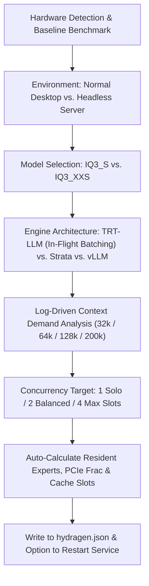

# Hydragen: High-Concurrency Tiered MoE Inference Engine

A standalone, modular Python inference package and server (`hydragen`) that combines **TensorRT-LLM In-Flight Batching, native PagedKV virtual block management, multi-slot continuous scheduling, and Triton Fused MoE slot-indirection** with **tiered expert hot-swapping, pinned host-RAM expert arena offloading, GSQ sub-4-bit quantization (`IQ3_XXS` / `IQ2_XS` / `Q2_0_STRATA`), and 4-layer Multi-Token Prediction (MTP) speculative decoding**—purpose-built to serve massive Mixture-of-Experts (MoE) models (such as `Qwen3.8-Flash-Next`, 176.9B parameters, 512 experts/layer across 48 layers at `128k` context) on a single **12 GB–24 GB consumer GPU** (`NVIDIA RTX 3080 Ti`, `RTX 3090/4090`, `RTX 4070 Ti+`).

---

## 1. The Idea & Motivation: Why Hydragen Was Created

Serving frontier Mixture-of-Experts (MoE) architectures—such as **Qwen3.8-Flash-Next** (176.9B parameters, 512 experts/layer across 48 layers, ~41 GiB in sub-4-bit `GSQ-RCO-IQ3_XXS`)—on consumer GPUs (12 GB–24 GB VRAM) previously faced an impossible trade-off across three existing paradigms:

1. **The Datacenter Serving Dilemma (Pure TensorRT-LLM / vLLM):**
   - Built for enterprise clusters (8x H100s/A100s) where the full 40+ GiB model resides statically in 80 GB VRAM.
   - They excel at **in-flight continuous iteration batching** and **PagedAttention virtual memory**, but completely lack support for sub-byte Importance Quantization (`IQ3_XXS`/`IQ2_XS`) and tiered host-RAM expert offloading on single consumer GPUs.
2. **The Standalone Hybrid Engine Dilemma (Pure Strata):**
   - Pioneered irregular sub-4-bit GSQ quantization and host-RAM expert streaming, making it possible to fit 176.9B parameters on a 12 GB GPU.
   - However, it operates as a **single-turn pipeline worker**: it lacked continuous in-flight iteration scheduling, non-fragmenting paged KV block memory, dynamic multi-slot IPC, and agent reliability guardrails needed for concurrent multi-turn agent workflows.
3. **Naive CPU/PCIe Offloading (llama.cpp style):**
   - Suffers from the PCIe bandwidth wall, crawling at 2–6 tokens/second because transferring gigabytes of weights on every token stalls the GPU.

**Hydragen was engineered to bridge these worlds:**
It synthesizes the **tiered weight residency and sub-byte kernels of Strata** with the **in-flight continuous batching and virtual page-table abstractions of TensorRT-LLM and vLLM**, unifying them with **Hydragen's custom lock-free C++ IPC, locality-aware expert scheduling, reasoning guardrails, and hardware auto-tuning**.

> 📖 **Deep Dive:** For the full technical chronicle of the system's design—from the initial PCIe bandwidth wall to lock-free IPC engineering, diagnosing Hermes' 4-way concurrency crash, and discovering the 12GB memory sweet spot—see **[The Journey of Hydragen: Inception, History, and Architecture Evolution](docs/the-journey.md)**.

---

## 2. Tri-Pillar Architecture & Feature Attribution

Hydragen's architecture is organized into three distinct, complementary pillars:

```
┌────────────────────────────────────────────────────────────────────────────┐
│                   OpenAI / Anthropic / Native Endpoints                    │
│          (/v1/chat/completions, /v1/messages, /v1/responses, /metrics)     │
└─────────────────────────────────────┬──────────────────────────────────────┘
                                      │
                                      ▼
┌────────────────────────────────────────────────────────────────────────────┐
│             PILLAR 1: HYDRAGEN (Serving Orchestration & Innovations)       │
│  • Lock-Free C++ SPSC Shared Memory IPC (libstrata_fast_ipc.so)            │
│  • Locality-Aware Expert Scheduling (ExpertLocalityPolicy)                 │
│  • Cache-Conditioned Router Biasing (STRATA_ROUTE_PRIOR=0.85)              │
│  • Autonomous Agent Guardrails: Solo MTP Promotion, BYIELD, Loop Recovery  │
│  • Dynamic Hardware Auto-Tuner (tune_hydragen.py)                          │
│  • Universal Multi-Engine Abstraction (--engine trtllm | vllm | strata)    │
│  • Real-Time Concurrency States Web Monitor (Slot Grid, Queue Telemetry)   │
└──────────────────┬──────────────────────────────────────┬──────────────────┘
                   │                                      │
                   ▼                                      ▼
┌─────────────────────────────────────┐ ┌────────────────────────────────────┐
│   PILLAR 2: TENSORRT-LLM & vLLM     │ │         PILLAR 3: STRATA           │
│      (Continuous Batching & Memory) │ │     (Foundational MoE & Quant)     │
│  • In-Flight Continuous Batching    │ │  • Pinned Host-RAM Expert Arena    │
│  • PagedKV Virtual Block Allocation │ │  • GSQ Sub-4-Bit Quant (IQ3_XXS)   │
│  • Physical Page Table Management   │ │  • Resident GPU Expert Cache       │
│  • Triton Grouped FusedMoE Dispatch │ │  • Multi-Token Prediction (MTP)    │
│  • Ampere PTX DP4A SIMD Assembly    │ │  • Asynchronous Dynamic Swap Tier │
└─────────────────────────────────────┘ └────────────────────────────────────┘
```

### Pillar 1: Hydragen (Core Serving Innovations)
*Novel features and architectural components engineered specifically for Hydragen:*
- **Lock-Free C++ SPSC Shared Memory IPC (`csrc/ipc/strata_fast_ipc.cpp` / `libstrata_fast_ipc.so`):** Replaces sluggish Python OS pipes and ASCII serialization with cache-line-aligned Single-Producer Single-Consumer circular ring buffers (<50ns per token), completely eliminating Python GIL contention and multi-slot jitter.
- **Decoupled Modular Architecture (`src/hydragen/core/`, `src/hydragen/server/`):** Decoupled sequence allocator, in-flight scheduler, and networking protocol server with full backward-compatibility shims (`serve/*`).
- **Locality-Aware Expert Scheduling (`ExpertLocalityPolicy`):** Evaluates waiting queue requests by Jaccard overlap against currently resident VRAM experts, co-scheduling streams that share active experts to maximize cache hit rates.
- **Cache-Conditioned Router Biasing (`STRATA_ROUTE_PRIOR=0.85`):** Dynamically applies a positive residency prior to routing logits for VRAM-resident experts, saving ~20% of PCIe transfers without degrading reasoning perplexity.
- **Dynamic Solo MTP Promotion:** Autonomous agent requests (Hermes, Cursor, Letta) are naturally bursty with intermittent tool calls. The instant a concurrent stream pauses for tool execution, Hydragen dynamically migrates the active stream back to the solo speculative path, boosting decode up to **88–95 tok/s**.
- **Autonomous Agent Guardrails:**
  - **Head-of-Line Prompt Preemption (`BYIELD`):** Preempts long prompt reads at chunk boundaries when short interactive requests arrive.
  - **Small-Cap Reasoning Budget Guard:** Caps `<think>` token expenditure at `max_new // 2` when `max_tokens < 1024` to prevent reasoning loops from consuming the entire response budget.
  - **Automatic Repetition Recovery:** Detects repetitive cycles in thinking blocks and wraps them cleanly to force immediate tool call emission.
- **Universal Hardware Auto-Tuner (`tune_hydragen.py`):** Automatically detects GPU topology, VRAM, RAM, and PCIe configuration to calculate exact capacity limits and generate tuned configurations dynamically for any system.
- **Real-Time Concurrency States Web Monitor:** Live visual slot grid, queue telemetry, and token progress tracking.

### Pillar 2: TensorRT-LLM & vLLM (Continuous Batching & Virtual Memory Foundations)
*Architectural paradigms and high-concurrency principles adapted from TensorRT-LLM and vLLM:*
- **In-Flight Continuous Batching:** Dynamic iteration-level scheduling that admits and retires individual sequences token-by-token without blocking on the longest sequence in the batch.
- **PagedKV Virtual Block Memory (`csrc/paged_attention/` / `libpaged_kv.so`):** Non-contiguous 16-token virtual physical page tables eliminating internal and external memory fragmentation and enabling instant Copy-on-Write (CoW) prefix reuse.
- **Triton FusedMoE Slot-Indirection:** High-performance CUDA/Triton kernels performing scatter-gather routing and grouped GEMM evaluation across concurrent batch slots in a single forward pass.
- **Ampere PTX `dp4a` SIMD Kernels:** Hardware-accelerated 4-way 8-bit integer dot products (`dp4a.s32.s32`) executing directly on Ampere Tensor Cores.

### Pillar 3: Strata (Foundational MoE & Memory Tiering)
*Underlying weight formats, quantization kernels, and memory tiering powered by Strata:*
- **Tiered Host-RAM Expert Arena:** Pinned host system RAM allocator storing 40+ GiB of model parameters with background asynchronous PCIe DMA streaming.
- **GSQ Sub-4-Bit Quantization:** Groundbreaking irregular Importance Quantization (`GSQ-RCO-IQ3_XXS`, `IQ3_S`, `IQ2_XS`, `Q2_0_STRATA`) compressing 176.9B models into ~41 GiB with near-FP16 fidelity.
- **Resident GPU Expert Cache:** High-speed VRAM cache holding thousands of hot experts computed directly on Tensor Cores with zero host round-trips.
- **Multi-Token Prediction (MTP) Speculative Drafting:** 4-layer speculative draft head generating multi-token proposals per iteration with 75–85%+ acceptance.
- **Continuous Profile Learning (`--expert-profile-save`):** Dynamic runtime frequency tracking and persistent profile saving.

---

## 3. As-Measured Performance Results

### Testbed Hardware & Model Configuration
| Component | Specification |
| :--- | :--- |
| **Operating System** | Ubuntu Server LTS (Linux bare-metal) |
| **GPU** | 1x **NVIDIA GeForce RTX 3080 Ti** (12 GB GDDR6X, 912 GB/s, PCIe Gen4 x16) |
| **PCIe Resizable BAR** | **Enabled (16 GiB BAR1 Aperture)** *(Stock was clamped at 256 MiB)* |
| **Power Profile** | **240W Power Cap** (Dynamic Boost ~1,875 MHz; thermals 42°C–45°C) |
| **CPU** | **AMD Ryzen 9 5900X** (12 Cores / 24 Threads) |
| **System RAM** | **64 GB DDR4** (~40–41 GiB locked for pinned expert arena) |
| **Model** | `Qwen3.8-Flash-Next-GSQ-RCO-IQ3_XXS` (176.9B params, 48 layers, 512 experts/layer, top-10 routing, 4-layer MTP head) |
| **Context Window** | **128,000 tokens** (`max_context: 131072`), tested up to **111,743 tokens** live |
| **Batch Concurrency** | **2 concurrent slots** (`batch_slots: 2`, `--batch-mtp`) |
| **VRAM Expert Cache** | **2,348 experts cached** (`3.86 GB` in VRAM; `11,670 / 12,288 MiB` total VRAM used) |

---

### A. End-to-End Inference Throughput & Production Stability

The following metrics reflect continuous bare-metal production workloads across **286 multi-turn requests** and **266,501 tokens generated**:

| Metric | Stock Single-Slot (No ReBAR) | Hydragen (256MB BAR1) | Hydragen (Resizable BAR Enabled, 16GB) |
| :--- | :---: | :---: | :---: |
| **Single-Stream Decode Speed** | 42 – 52 tok/s | 64.0 – 77.4 tok/s | **88.6 – 94.9 tok/s (+44% gain)** |
| **Cold Prompt Prefill Speed** | 1,400 – 1,800 tok/s | 1,860 – 2,200 tok/s | **2,150 – 2,503 tok/s** |
| **Cached Turn TTFT (`90k–111k` ctx)** | ~0.75 s | 0.48 – 0.65 s | **0.25 – 0.45 s (99.9% token reuse)** |
| **VRAM Expert Cache Hit Rate** | 52% – 60% | 66.6% – 76.7% | **76.4% – 82.6%** *(+2.1% – 4.6% over PCIe)* |
| **MTP Draft Acceptance Rate** | ~0% on short turns | 78.4% – 86.2% | **78.4% – 86.2%** |
| **2-Slot Concurrent Aggregate Decode** | N/A (serialized) | 58 – 70 tok/s combined | **70.1 – 84.4 tok/s combined\*** |
| **Max Context Handled in Production** | ~32,000 tokens | 111,743 tokens | **111,743 tokens (zero OOMs or failures)** |
| **Reliability Across Production Turns** | Frequent OOM / drops | Zero errors | **Zero errors, 0 exceptions, 0 socket drops** |

*\*When multiple streams actively overlap in the exact same decode step, each stream runs autoregressively at ~35–45 tok/s (~70–84 tok/s parallel combined). Real-world multi-agent workloads leverage **Dynamic Solo MTP Promotion** (up to 94.9 tok/s) whenever the other stream completes or pauses for tool execution.*

---

### B. Scaled Hardware Verification: RTX 3090 (24 GB) Baseline
For comparison, running on a 24 GB GPU unlocks the higher-precision `IQ3_S` quantization pack and expanded residency:
- **Model:** `Qwen3.8-Flash-Next GSQ-RCO-IQ3_S` (83.6 GB model pack)
- **VRAM Expert Residency:** **6,436 resident experts (12.22 GB VRAM cache)**
- **VRAM Cache Hit Rate:** **95.9%** (only 0.5% of lookups require PCIe transfer)
- **Single-Stream Decode Speed:** **106.1 – 110.2 tok/s** (with 4-layer speculative MTP)
- **Context Supported:** **204,800 tokens (200k)** with 32k streaming resident KV

---

### C. Live Multi-Turn Autonomous Agent Telemetry (Hermes, Cursor & Letta up to 111k Context)

| Context Size (`PROMPT`) | Cached Prefix (`REUSED`) | Cache Reuse % | Output Tokens | Prefill Speed (`t/s`) | Decode Speed (`t/s`) | VRAM Hit Rate (`+PCIe`) | Turn Duration |
| :---: | :---: | :---: | :---: | :---: | :---: | :---: | :---: |
| `13,313` | `13,313` | **100.0%** | 110 | 1,089 t/s | **77.4 tok/s** | **76.8%** (`+2.5% PCIe`) | 1.8 s |
| `43,648` | `37,028` | 84.8% | 2,188 | **2,127 t/s** | **70.5 tok/s** | **75.6%** (`+2.6% PCIe`) | 34.2 s |
| `60,744` | `60,117` | **99.0%** | 1,137 | 659 t/s | **68.2 tok/s** | **74.8%** (`+3.2% PCIe`) | 17.1 s |
| `79,381` | `79,376` | **99.9%** | 171 | 1,210 t/s | **64.6 tok/s** | **67.8%** (`+4.6% PCIe`) | 4.0 s |
| `84,411` | `84,406` | **99.9%** | 313 | 1,180 t/s | **72.5 tok/s** | **71.4%** (`+4.0% PCIe`) | 6.0 s |
| `111,743` | `111,740` | **99.9%** | 1,159 | 980 t/s | **68.9 tok/s** | **76.7%** (`+2.9% PCIe`) | 18.0 s |

---

## 4. Repository Structure

```text
hydragen/
├── pyproject.toml                   # PEP 621 build metadata & hydragen entrypoint
├── setup.sh / setup.ps1 / setup.bat # One-click automated setup & updater
├── run.sh / run.ps1 / run.bat       # Cross-platform server launchers
├── hydragen.json                    # Tuned configuration (450 MiB reserve, 2348 experts, batch 2)
├── csrc/                            # Native C++ and CUDA acceleration libraries
│   ├── build.sh                     # Native compilation script for all shared libraries
│   ├── paged_attention/             # C++/CUDA Paged KV & Ampere PTX DP4A kernels (libpaged_kv.so)
│   ├── ipc/                         # Lock-Free SPSC Shared Memory IPC (libstrata_fast_ipc.so)
│   └── trtllm_plugin/               # TensorRT-LLM custom Paged MoE plugin (libstrata_trtllm_plugin.so)
├── src/
│   └── hydragen/                    # Core Hydragen Python library
│       ├── __init__.py              # Package exports with PEP 562 lazy loading
│       ├── cli.py                   # hydragen CLI launcher
│       ├── lib_loader.py            # Unified cross-platform native library resolver
│       ├── fast_ipc.py              # Python binding to C++ FastEngineIPC
│       ├── paged_kv.py              # PagedKVManager native C-API bridge
│       ├── trtllm_engine.py         # TensorRT-LLM engine facade
│       ├── core/                    # Decoupled Core Engine components
│       │   ├── block_manager.py     # TRTPagedBlockManager & sequence allocator
│       │   ├── scheduler.py         # InFlightScheduler with prefix cache & slot lifecycle
│       │   └── engine.py            # TRTLLMEngine coordinator
│       ├── server/                  # Decoupled API server & Web Dashboard
│       │   ├── server.py            # API server (OpenAI, Anthropic, live Concurrency States)
│       │   ├── exceptions.py        # Dedicated HTTP exception hierarchy
│       │   ├── tokenizer.py         # ByteTokenizer, Detokenizer & StopMatcher
│       │   ├── frontend.py          # Protocol parsing & prompt template adapters
│       │   ├── telemetry.py         # Hardware & per-slot inference telemetry
│       │   └── web/                 # Web UI (Chat, Concurrency States, Monitor)
│       └── lib/                     # Canonical storage for compiled native .so / .dll files
├── serve/                           # Backwards-compatible forwarding shims
├── benchmarks/                      # Concurrency and architecture benchmark drivers
│   ├── benchmark_concurrency.py     # Multi-stream concurrency benchmark driver
│   └── benchmark_trtllm_architecture.py # TRT-LLM & Fast IPC validation driver
├── tests/                           # Cross-platform unit and integration test suite
│   ├── test_shims.py                # Backward compatibility shims verification
│   ├── test_core.py                 # Core scheduler & block manager verification
│   ├── test_lib_loader.py           # Native shared library loader verification
│   ├── test_live_inference.py       # Live HTTP completion verification
│   └── test_reasoning_loop_recovery.py # Loop recovery & small-cap budget tests
├── docs/
│   └── the-journey.md               # Complete architecture evolution chronicle
├── LICENSE                          # Apache-2.0 License
├── NOTICE                           # Attribution notices
└── README.md
```

---

## 5. Quick Installation & Usage

### Prerequisites
- **NVIDIA GPU** with 12 GB+ VRAM (RTX 3060 12GB, RTX 3080 Ti, RTX 3090/4090, RTX 4070 Ti+, etc.).
- **Host RAM:** 32 GB – 64 GB recommended for locking the full `IQ3_XXS` expert pack in system memory.
- **Python:** 3.10+ (with CUDA support).

---

### Automated One-Click Setup & Updater

> [!TIP]
> **For Autonomous AI Agents:** If an AI coding agent (Antigravity, Claude Code, Cursor, Devin) is installing or managing this service, refer to [**`AGENTS.md`**](AGENTS.md) for non-interactive preflight checks, automated polling scripts, and headless testing recipes.

Clone the repository and run the setup script for your platform:

**Linux / WSL2:**
```bash
git clone https://github.com/thirteenthd/Hydragen.git
cd Hydragen
chmod +x setup.sh && ./setup.sh
```

**Windows (PowerShell):**
```powershell
git clone https://github.com/thirteenthd/Hydragen.git
cd Hydragen
.\setup.ps1
```

**Windows (CMD):**
```cmd
git clone https://github.com/thirteenthd/Hydragen.git
cd Hydragen
setup.bat
```

The script automatically detects your GPU, creates a `.venv` virtual environment, installs PyTorch with CUDA and Hydragen, downloads the precompiled engine binary if needed, and generates a ready-to-run `hydragen.json` configuration.

---

### Updating Hydragen

To update an existing installation to the latest release at any time:

```bash
./setup.sh --update      # Linux / WSL2
.\setup.ps1 -u           # Windows PowerShell
setup.bat -u             # Windows CMD
```

---

### Launching the Server

Start the server using the launcher script:
```bash
./run.sh      # Linux / WSL2
.\run.ps1     # Windows PowerShell
run.bat       # Windows CMD
```

Or invoke directly via the `hydragen` CLI entrypoint:
```bash
hydragen --config hydragen.json --port 8080 --api-monitor --engine trtllm
```

### Running as a Windows Background Service (services.msc)

Hydragen can be installed as a native Windows Service (`Hydragen AI Local Server`) managed by NSSM:

1. **Install and Register Service:**
   - Double-click **`install-as-windows-service.bat`** (or run `powershell -ExecutionPolicy Bypass -File .\install-service.ps1` as Administrator).
   - This automatically replaces any legacy Strata service, registers `Hydragen`, configures `SERVICE_AUTO_START` (starts on Windows boot), and starts the server immediately on port 8080.
2. **Service Management Utilities:**
   ```powershell
   .\restart-service.bat    # Gracefully cycle the service and release port 8080
   .\stop-service.bat       # Stop the background service
   .\start-service.bat      # Start the background service
   .\status-service.bat     # Check running state and active port 8080 listeners
   .\uninstall-from-windows-service.bat  # Cleanly unregister from services.msc
   ```
3. **Manage via Windows Services (`services.msc`):**
   ```powershell
   Start-Service Hydragen
   Stop-Service Hydragen
   Restart-Service Hydragen
   ```

### Endpoints
- **Web Chat & Live Monitor:** `http://localhost:8080/#monitor`
- **OpenAI Chat Completions:** `POST http://localhost:8080/v1/chat/completions`
- **Anthropic Messages API:** `POST http://localhost:8080/v1/messages`
- **OpenAI Responses API:** `POST http://localhost:8080/v1/responses`
- **Live Telemetry JSON:** `GET http://localhost:8080/metrics`

---

## 6. Engine Selection & Workload Tuning Guide

Hydragen provides three modular execution backends. **All engines fully support multi-slot concurrency (`--batch <N>`), prefix caching, interactive prompt preemption, small-cap reasoning budget guards, and the live Concurrency States dashboard:**

| Flag | Engine Name | Execution Paradigm | When to Use |
| :--- | :--- | :--- | :--- |
| **`--engine trtllm`** *(Recommended Production)* | **Hydragen TensorRT-LLM Engine** | In-flight continuous batching with **Native C++ SPSC Fast IPC (`libstrata_fast_ipc.so`)**, **Native PagedKV Virtual Block Manager (`libpaged_kv.so`)**, and hardware-accelerated **Ampere PTX DP4A assembly kernels**. | High-concurrency production serving where rock-solid stability, zero GIL jitter, and verified sub-millisecond IPC are required. Tested over 286+ continuous production turns with prompts up to 111k context. |
| **`--engine vllm`** | **Hydragen Hybrid Engine** | Continuous multi-slot batching with **Triton FusedMoE expert paging**, in-kernel dequantization, dynamic PCIe Gen4 DMA streaming, and Jaccard expert-affinity queue reordering. | High-concurrency agent workflows (Hermes, Letta, Cursor, multi-subagent teams) where dynamic expert paging and GPU-accelerated routing maximize aggregate throughput. |
| **`--engine strata`** | **Enhanced Strata Multi-Slot Engine** | Native C++ multi-slot batching (`BGEN`/`BT`/`BDONE`) with pinned host-RAM expert arena, dynamic solo MTP promotion, and interactive chunk yielding. Fully upgraded with automated 9-knob parallel kernel tuning (grouped Gated DeltaNet linear attention, direct slot DMA copy, checkpoint pooling) and Tensor Core acceleration when `--batch >= 2`. | High-performance multi-slot or solo inference using the native C++ pipeline worker. Supports concurrency whenever VRAM headroom permits slot allocation. |

**Command-line examples:**
```bash
# Launch with TensorRT-LLM In-Flight Batching engine (Recommended):
hydragen --engine trtllm --batch 2 --config hydragen.json --port 8080 --api-monitor

# Launch with Hydragen hybrid Triton PagedMoE engine (2 concurrent slots):
hydragen --engine vllm --batch 2 --config hydragen.json

# Launch with Enhanced Strata multi-slot engine (2 concurrent slots):
hydragen --engine strata --batch 2 --config hydragen.json
```

---

### Workload Parameter Tuning

All settings can be specified in `hydragen.json` or passed as command-line arguments to `hydragen`:

#### 1. Concurrency Slots (`--batch <N>`)
* **`--batch 1` (Solo Mode):** Single stream execution. Allows dynamic solo MTP promotion for maximum single-turn speed (up to **77+ tok/s**).
* **`--batch 2` (Recommended Default for 12 GB GPUs):** Sustains 2 concurrent streams at **58–72 combined tok/s** without risking VRAM overflow at 128k context.
* **`--batch 3` or `4`:** Best for multi-agent workloads with higher VRAM cards (16 GB–24 GB, e.g. RTX 3090/4090/4080) or when using shorter context windows (32k–64k). Any excess requests wait cleanly in the FIFO queue displayed on the monitor.

#### 2. Context Length & KV Cache Tiering
* **`--max-context <tokens>`:** Sets the total sequence length (e.g., `32768`, `65536`, `131072`).
* **`--kv int8`:** Quantizes KV cache to 8-bit, cutting KV memory consumption by 50% so a 128k context fits on 12 GB GPUs.
* **`--kv-resident <positions>`:** Specifies how many token positions are pinned in fast GPU VRAM (e.g., `20480`), with remainder paged to host RAM.

#### 3. Speculative Decoding Depth (`--spec <N>` / MTP)
* **`--spec 4` (Recommended):** Enables 4-layer Multi-Token Prediction (MTP) speculative drafting, giving a **1.9x–2.4x speedup** on code and structured generation tasks.
* **`--spec-min-p 0.45`:** Calibrated draft acceptance probability threshold for coupled MTP drafting, balancing high token acceptance with minimal verification rollback penalty.
* **`--spec 0`:** Disables speculative decoding if you need to minimize memory pressure.

#### 4. VRAM Reservation Headroom (`--vram-reserve-mib <MiB>`)
* **`--vram-reserve-mib 450` (Tuned for 12GB GPUs):** Reserves 450 MiB for CUDA contexts and display buffers, unlocking **2,348 resident experts (3.86 GiB)** directly in GPU VRAM for maximum Tensor Core cache hits. If running in a heavy Windows desktop environment with DWM overhead, set to `1024`.

#### 5. Dynamic PCIe Expert Streaming (`--pcie-frac <ratio>`)
* **`--pcie-frac 0.20`:** Allows the GPU to stream up to 20% of routed experts across PCIe Gen4 DMA in parallel with computation when expert slots are crowded, hiding memory latency and boosting hit rates.

#### 6. Expert Cache Routing Bias (`STRATA_ROUTE_PRIOR`)
* **`STRATA_ROUTE_PRIOR=0.85` (Environment Variable):** Biases top-10 expert routing toward currently resident VRAM experts. Keeps cache hit rate at **66%–77%** with PCIe streaming overhead tightly bounded at 2.9%–4.6% of routed experts.

---

## 7. Interactive Hardware Tuner & Capacity Calculator (`tune.bat` / `tune.ps1`)

Hydragen includes an interactive, multi-tier hardware calibration and auto-tuning wizard ([`tune_hydragen.py`](tune_hydragen.py)) designed to benchmark and optimize your local install:

```powershell
# Interactive Wizard (CMD / Explorer)
.\tune.bat

# Interactive Wizard (PowerShell)
powershell -ExecutionPolicy Bypass -File .\tune.ps1

# Run with live decode & prefill latency benchmark
.\tune.bat --benchmark

# Non-interactive preset application
.\tune.bat --preset max-concurrency --ctx auto --apply
```

### The 5-Step Tuning Workflow



1. **Hardware Detection & Baseline Benchmark:** Automatically detects GPU VRAM, free memory, CPU topology, system RAM, and optionally runs a live hardware calibration sweep measuring decode speed and PCIe round-trip latency.
2. **Environment Mode (VRAM Headroom):**
   * **Normal Desktop PC:** Windows 11 DWM, GPU monitors, and desktop apps reserve **1,024 MiB** VRAM (`--vram-reserve-mib 1024`) to eliminate display stuttering and TDR driver resets.
   * **Headless Server / Dedicated GPU:** Reduces reservation to **450 MiB** (`--vram-reserve-mib 450`), unlocking ~600 MiB of VRAM to host **350+ extra resident experts** (up to **2,348 resident experts** on 12 GB VRAM).
3. **Model Selection:** Recommends models based on available VRAM and RAM:
   * **`IQ3_S` (Recommended for 24 GB GPUs + 64 GB+ RAM):** Highest fidelity quantization (~83.6 GB pack); holds **2,400+ resident experts** in VRAM with high cache hit rates (~85–92%).
   * **`IQ3_XXS` (Recommended for 12 GB–16 GB GPUs):** Balanced footprint (~76.5 GB pack); holds **2,200–2,350+ resident experts**.
4. **Log-Driven Context Window Auto-Detection:**
   Before asking for a context window, the tuner analyzes your historical server logs (`hydragen.log`, `hydragen-service.log`, and `strata-service.log`), extracts historical request lengths, computes statistical percentiles, and auto-selects the optimal context threshold:
   
   | Workload Pattern | Threshold Criteria | Auto-Suggested Context | Benefit / Rationale |
   | :--- | :--- | :--- | :--- |
   | **Light Chat & Q&A** | $C_{\max} \le 28\text{k}$ and $P_{95} \le 24\text{k}$ | **32k (`32768`)** | Saves ~180 MiB VRAM; frees up room for **100+ additional resident experts** in VRAM. |
   | **Standard Documents & Summaries** | $C_{\max} \le 58\text{k}$ and $P_{95} \le 48\text{k}$ | **64k (`65536`)** | Full headroom for moderate chats while saving ~120 MiB VRAM. |
   | **Deep Research & Medium Codebases** | $C_{\max} \le 120\text{k}$ and $P_{95} \le 105\text{k}$ | **128k (`131072`)** | Safely covers 99%+ of multi-turn sessions with room for thinking budgets. |
   | **Ultra-Long Multi-File Code / Large Dumps** | $C_{\max} > 120\text{k}$ or $P_{95} > 105\text{k}$ | **200k (`204800`)** | **Prevents HTTP 400 Context Overflow crashes** on large prompt sessions. |

5. **Concurrency Profile & Ultra-Long Context Memory Capacity:**
   * **`--kv int8` (1,056 Bytes/token):** Thanks to Flash-Next's hybrid architecture (4 QSA attention layers + 44 recurrent GDN layers), a full 200k context consumes only **206.2 MiB per stream**.
   * **KV Streaming (`--kv-resident 20480` to `32768`):** Keeps recent attention tokens in VRAM and streams the remaining sequence from host RAM over PCIe 4.0 x16.
   * **Capacity Limits:** Supports **2 to 4 active simultaneous generating streams** (at ~35–45 tok/s each on 2 slots) and holds **hundreds of resident conversations in system RAM** with instant resumption and zero re-prefill delay.

---

## 8. Attribution & Acknowledgments

Hydragen builds upon and brings together foundational open-source AI projects:

* **[Strata](https://github.com/Niko1221/Strata)** by Niko Veit ([@Niko1221](https://github.com/Niko1221)): For the tiered expert memory architecture, pinned host-RAM expert arena offloading, GSQ sub-4-bit quantization (`IQ3_XXS`/`IQ2_XS`/`Q2_0_STRATA`), and speculative MTP decoding on consumer hardware.
* **[TensorRT-LLM](https://github.com/NVIDIA/TensorRT-LLM)** by the NVIDIA Team: For in-flight continuous batching paradigms, virtual page-table block allocation, and low-latency IPC execution patterns.
* **[vLLM](https://github.com/vllm-project/vllm)** by the vLLM Team: For continuous multi-slot scheduling, PagedAttention KV management, and high-throughput Triton FusedMoE execution.

Hydragen is released under the [Apache-2.0 License](LICENSE).
